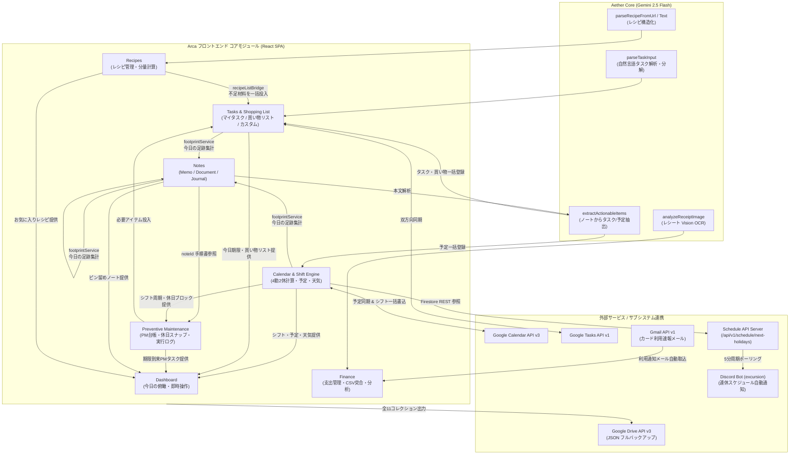

# Arca システム全体仕様・構造マップ（AI / 開発者向けリファレンス）

- **作成日（現在日付）**: **2026年10月17日 (`2026-10-17`)**
- **対象リポジトリ**: `c:\Users\村岡真聡\Documents\Arca`
- **ドキュメントの目的**: AI エージェントおよび開発者が、ファイル群を個別に探索することなく「Arca の全体像・全機能・機能間連携・外部 API・設定/キーの所在・ディレクトリ構造・データモデル」を一読で完全に把握するための構造化コンテキストファイル。

---

## 1. システム全体像（System Overview）

### 1.1 システムの目的と概要
**Arca（アルカ）** は、**「4勤2休（4日勤務・2日休日）」のシフトリズム**で生活するユーザー個人のために専用設計された、シングルユーザー向け統合パーソナル OS（Web / PWA アプリケーション ＋ 常駐 API サーバー ＋ Discord 通知 Bot）です。

一般的なカレンダーやタスク管理ツールが前提とする「月曜〜金曜勤務・土日祝休み」という固定概念を排し、**「4勤2休のシフトサイクル」をシステム全体の時間軸の中心（コアエンジン）** に据えています。タスク管理、買い物リスト、カレンダー、予防保全（定期メンテナンス）、3空間ノート（メモ・ドキュメント・日記）、レシピ管理、家計・支出管理（レシート OCR・カード利用通知メール取込・明細 CSV 突合）、および Discord への次回連休自動通知が単一のシステムとして有機的に結合されています。

### 1.2 4つのコア設計哲学（`Core/` 定義）
1. **シフト中心設計（Shift-Centric Architecture）**:
   4勤2休サイクル計算エンジン（`src/services/pmCycleService.ts`）が算出する勤務日・休日ブロックを、カレンダー表示、ダッシュボード、予防保全（PM）の次回予定日スナップ計算、Discord 自動通知のすべてが共有します。
2. **静謐な UI（Apple HIG × Quiet Luxury）**:
   アイボリー・チャコール・マットゴールドを基調とした6種類のテーマ（`ivory`, `dark`, `sand`, `sage`, `prism`, `system`）を備え、不要な枠線（Border）を排して多層シャドウと余白で情報階層を表現します。
3. **Aether Core（黒子の AI エンジン）**:
   独立したチャットボット画面を持たず、ユーザーの入力や操作の裏側で Gemini 2.5 Flash が「自然言語からのタスク属性抽出・サブタスク分解」「ノート本文からのタスク/予定抽出」「レシピ URL/テキストの構造化」「レシート画像の Vision OCR 解析」を自動的に遂行します。
4. **Local-First & オフライン耐性**:
   Cloud Firestore のマルチタブ対応 IndexedDB 永続化キャッシュ（`persistentLocalCache` + `persistentMultipleTabManager`）と `localStorage` キャッシュを組み合わせ、オフライン時や起動直後でも待ち時間ゼロで画面を描画・操作できます。

### 1.3 システム構成レイヤー（3層ハイブリッド構成）
1. **フロントエンド SPA / PWA (`src/`)**:
   React 19 + TypeScript + Vite 8 で構築され、Firebase Hosting（`arca-f3fc6`）上でホストされるメインアプリケーション。
2. **Schedule API サーバー (`src/api/`)**:
   Firestore REST API から最新のシフト設定・予定を取得して「現在および次回の休日ブロック」を算出・返却する軽量 HTTP サーバー（開発時は Vite プラグインとしてポート `5173` で稼働、常駐時は Node.js 単体サーバーとしてポート `3000` で稼働）。
3. **Discord 自動通知 Bot サブシステム (`excursion/`)**:
   Python (`discord.py`) で実装された常駐 Bot。Schedule API を5分周期でポーリングし、休日ブロック終了直後（翌日 00:00 JST 以降）に次回の連休スケジュールを Discord チャンネルへ自動通知します。

### 1.4 技術スタック一覧
| レイヤー | 採用技術・パッケージ | バージョン | 用途・役割 |
| :--- | :--- | :--- | :--- |
| **Frontend UI** | React / React DOM | `^19.2.8` | コンポーネント構築・状態管理 |
| **Language** | TypeScript | `~6.0.2` | フロントエンドおよび Node API の型安全な実装 |
| **Build / Dev Server** | Vite | `^8.2.0` | バンドル、HMR、開発時 Schedule API ミドルウェア統合 |
| **PWA / SSL** | `vite-plugin-pwa`, `@vitejs/plugin-basic-ssl` | `^1.2.0`, `^2.2.0` | Service Worker 自動更新、Web App Manifest、開発用 HTTPS |
| **Styling** | Tailwind CSS v4 (`@tailwindcss/postcss`) + CSS Variables | `^4.3.3` | 6テーマ対応デザイントークン (`--arca-*`) とレイアウト |
| **Rich Text / Markdown** | `@tiptap/react`, `tiptap-markdown`, `react-markdown`, `remark-gfm`, `remark-breaks` | `^3.20.4`, `^0.9.0`, `^10.1.0` | Notes の WYSIWYG ⇄ Markdown ハイブリッド編集・描画 |
| **Icons** | `lucide-react` | `^1.16.0` | ミニマル UI アイコン |
| **BaaS / Database** | Firebase (Firestore, Auth, Storage, Hosting) | `^12.17.1` | NoSQL リアルタイム DB、Google 認証、WebP 画像保管、ホスティング |
| **AI / LLM** | Google Gemini API (`gemini-2.5-flash`) | REST `v1beta` | タスク解析、ノート抽出、レシピ解析、レシート Vision OCR |
| **API Runtime** | Node.js `http` + `tsx` | `^4.21.0` | スタンドアロン Schedule API サーバー (`npm run api`) |
| **Discord Bot** | Python + `discord.py` + `aiohttp` + `python-dotenv` | `>=2.3.0`, `>=3.9.0` | 次回休日ブロックの監視・Discord 自動投稿・スラッシュコマンド |
| **Test / Lint** | Vitest + Testing Library + `happy-dom` + `oxlint` | `^4.1.11`, `^1.75.0` | シフト計算・CSV 突合等の単体テストおよび高速静的解析 |

---

## 2. 機能一覧と機能間の関連性・データフロー（Features & Inter-Module Relationships）

### 2.1 全機能モジュール詳細と他機能との関連性

#### ① Dashboard（俯瞰ダッシュボード）— `src/components/Dashboard.tsx`
- **機能詳細**:
  - 時間帯に応じた挨拶メッセージと本日の日付・曜日・4勤2休シフトバッジの表示。
  - 京都府福知山市の週間天気予報ストリップと、現在/次回の休日ブロック表示。
  - 「今日のタスク（最大5件・その場で完了/新規追加可）」「今日のカレンダー予定」「買い物リスト（最大6件・その場でチェック/追加可）」「実施時期が到来した予防保全（PM）タスク」「ピン留めノート」「お気に入りレシピ」を1画面に集約。
- **他機能との関連性**:
  - **シフト計算 (`pmCycleService`)** と **カレンダー予定 (`events`)** を参照して本日のシフトと次回連休を算出。
  - **Tasks (`tasks`)** のうち `listId: "default"`（期限が今日以前または未設定）を「今日のタスク」として、`listId: "shopping"` を「買い物リスト」として直接読み書き。
  - **PM 台帳 (`pm_masters`)** の次回予定日 (`nextScheduledDate`) を監視し、期限到来タスクがあれば `PMExecutionPopover` を起動してその場で完了記録が可能。
  - **Notes (`notes`)** の `pinned: true` ノート、**Recipes (`recipes`)** の `favorite: true` レシピを表示し、クリック時に `App.tsx` のディープリンク関数 (`handleNavigateToNote`, `handleNavigateToRecipe`) を介して該当アイテムの詳細画面へ直接遷移。

#### ② Tasks & Shopping List（タスク＆買い物リスト統合管理）— `src/components/Tasks.tsx`
- **機能詳細**:
  - 「マイタスク (`listId: "default"`)」「買い物リスト (`listId: "shopping"`)」およびユーザーが自由に追加・編集・アイコン設定できるカスタムリスト (`task_lists`) を、スライディングピル型タブで切り替えて管理。
  - タスクの優先度 (`high` / `medium` / `low`)、期限日 (`dueDate`)、メモ (`notes`)、無制限のサブタスク (`subtasks`)、ドラッグ＆ドロップ並び替え (`order`)、5秒間の削除 Undo トーストに対応。
  - **Aether Core 自然言語入力**: 入力欄の Sparkle アイコン ON 時、「来週金曜までに企画書提出 重要」のような入力から `parseTaskInput()` が期限・優先度・カテゴリを自動抽出し、さらに3〜5個の具体的なサブタスクへ自動分解。
  - **Google Tasks 双方向同期 (`googleTasksSync.ts`)**: リスト・タスク・サブタスク（Google Tasks 側の `parent` フィールド）を Google Tasks API v1 と双方向同期。
- **他機能との関連性**:
  - **Calendar 連携**: `dueDate` が設定された未完了タスク（買い物リスト除く）は、`Calendar.tsx` の該当日のセルにタスクバッジとして自動表示される。
  - **Recipes からの流入 (`recipeListBridge.ts`)**: レシピ詳細画面で選択された材料が `listId: "shopping"` に一括追加される（既存同名アイテムがある場合は分量を文字列連結で自動合算）。
  - **PM（予防保全）からの流入 (`PMExecutionPopover.tsx`)**: 定期メンテナンスに必要な消耗品・アイテム (`itemTemplates`) をワンタップで `listId: "shopping"` へ追加可能。
  - **Notes からの流入 (`AetherExtractModal.tsx`)**: ノート本文から AI が抽出したアクションアイテムや買い物リスト項目が `tasks` コレクションへ一括登録される。
  - **Journal への出力 (`footprintService.tsx`)**: その日に完了または作成したタスクが、日記（Journal Space）の「今日の足跡」スナップショットに集計される。

#### ③ Calendar & 4勤2休シフトエンジン — `src/components/Calendar.tsx`, `src/services/pmCycleService.ts`
- **機能詳細**:
  - 月間カレンダーグリッド上に、各日の「4勤2休シフトバッジ（1日目〜4日目、休1〜休2）」「週間天気アイコン」「予定 (`events`)」「期限付きタスク (`tasks`)」「PM 予定 (`pm_masters`)」を統合表示。
  - **シフト自動算出＆手動オーバーライド**:
    1. `shift_settings/main` の基準日 (`manualAnchorDate`) と周期 (`cycleLength = 6`) から基本サイクルを算出。
    2. `autoDetectWorkShift: true` の場合、カレンダー予定に「仕事」「出勤」「勤務」「work」等を含む予定 (`isWorkEvent`) があれば、その連続ブロックからシフト日数を自動補正。
    3. 特定の日付に対する手動オーバーライド (`overrides[YYYY-MM-DD]`) が最優先で適用される。
  - **Google Calendar 双方向同期 (`googleCalendarSync.ts`)**: Google Calendar (`primary`) との予定双方向同期に加え、算出した4勤2休シフト予定（`isShiftOnly: true`）を Google Calendar へ一括登録・更新する機能 (`batchUpdateShiftEvents`) を搭載。
- **他機能との関連性**:
  - 算出されたシフト情報 (`ShiftDayInfo`) は **Dashboard**、**PM（予防保全）の休日スナップ計算**、および **Schedule API サーバー (`scheduleService.ts`) -> Discord Bot (`excursion`)** のすべてで共通のスケジュール基盤として使用される。

#### ④ Preventive Maintenance / 予防保全（PM）— `src/components/pm/`, `src/services/pmMasterService.ts`
- **機能詳細**:
  - 掃除・設備メンテナンス・消耗品交換などの定期ルーチンを管理するモジュール。
  - **PM 台帳 (`pm_masters`)**: 周期（日/週/月/年）、起算方式（固定周期 `FIXED` / 完了日基準 `COMPLETION_BASED`）、**実施タイミング（`HOLIDAY`: 4勤2休の休日1日目・2日目・Nサイクルごと / `ANY`: 曜日・シフト不問）**、標準時間（分）、手順書ノート ID (`noteId`)、必要アイテム (`itemTemplates`)、サブタスクチェックリスト (`taskTemplates`) を定義。
  - **休日自動スナップ計算 (`calculateNextScheduledDate`)**: 次回予定日を計算する際、`timingCategory: "HOLIDAY"` が指定されていれば、4勤2休シフトエンジンを参照して該当する「休日1日目」または「休日2日目」へ予定日を自動吸着（スナップ）させる。
  - **PM 実行＆実績ロギング (`PMExecutionPopover.tsx`)**: チェックリスト消化と実績時間 (`actualMinutes`) を記録して `pm_logs` に保存し、次回予定日を更新。
- **他機能との関連性**:
  - **Calendar & Shift 連携**: 4勤2休の休日ブロックに合わせてメンテナンス予定日が自動調整され、カレンダーとダッシュボードに表示される。
  - **Notes 連携**: PM 台帳に `noteId` を紐付けることで、メンテナンス実行画面から Notes（Document Space）の手順書ページをワンクリックで参照可能。
  - **Shopping List 連携**: メンテナンスに必要な消耗品をワンタップで Tasks の「買い物リスト」へ投入可能。

#### ⑤ Notes / Knowledge（3空間ハイブリッドノート）— `src/components/Notes.tsx`, `src/components/notes/`
- **機能詳細**:
  - 単一の `notes` コレクションを `spaceType` フィールドによって3つの知識空間として切り替えるアーキテクチャ：
    1. **Memo Space (`spaceType: "memo"`)**: Google Keep 風のカードグリッド UI。素早いメモ取り・ピン留め・カラー/タグ管理に特化。
    2. **Document Space (`spaceType: "document"`)**: Notion / Obsidian 風の無制限階層ツリー構造（`parentId`, `order`）。左サイドバーツリー (`DocumentSidebarTree`)、パンくずリスト (`NoteBreadcrumbs`)、目次 (`TableOfContents`)、サブページ一覧（リスト/カード表示切替）、ページ移動モーダル（循環参照防止チェック付）を搭載。
    3. **Journal Space (`spaceType: "journal"`)**: Apple Journal 風の日付 (`journalDate`) 紐付け日記空間。6段階のムード選択 (`MoodPicker`: `great`, `good`, `neutral`, `tired`, `stressed`, `sad`)、カレンダーウィジェットを備える。
  - **TipTap v3 エディタ (`NoteEditor.tsx`)**: WYSIWYG リッチテキスト編集と Markdown ソースを双方向変換。テーブル、タスクリスト、コードブロック、および画像のドラッグ＆ドロップ WebP 圧縮アップロード（Firebase Storage `imageUploadService.ts`）に対応。
  - **ごみ箱（ソフトデリート）**: `isDeleted: true` による安全なごみ箱移動と復元・完全削除。
- **他機能との関連性**:
  - **Aether Extract (`AetherExtractModal.tsx`)**: ノート本文を Gemini 2.5 Flash で解析し、文中に含まれる「やるべきタスク」「買うもの」「カレンダー予定」を自動抽出して **Tasks** および **Calendar** へ一括登録。
  - **今日の足跡 (`footprintService.ts`)**: Journal Space で日記を書く際、指定日に完了/作成した **Tasks**、**Calendar** の予定、更新した **Notes** を自動収集し、Markdown の振り返りログとして日記本文へワンクリック挿入。
  - **PM 連携**: Document Space のノートを PM 台帳の手順書 (`noteId`) としてリンク可能。

#### ⑥ Recipes（AI レシピストック＆分量スケーリング）— `src/components/recipes/`
- **機能詳細**:
  - レシピのカードグリッド/リスト表示、タグフィルタ、お気に入り登録、調理ステップの進捗チェック機能。
  - **人数スケーリング計算 (`RecipeDetail.tsx`)**: 基準人数 (`servings`) を変更すると、`ingredients` 内の数値（整数・小数・分数）を正規表現でパースしてリアルタイムに分量を自動再計算。
  - **AI レシピ自動インポート (`recipeParser.ts`)**:
    - **URL インポート**: 外部レシピサイトの URL を入力すると、3段階の公開 CORS プロキシ経由で HTML を取得。HTML 内に `schema.org/Recipe` (JSON-LD) があれば優先抽出し、不足情報やテキストの整形を Gemini 2.5 Flash で補完して構造化。
    - **テキストインポート**: SNS や Web ページからコピーしたレシピ文章を貼り付けるだけで、Gemini 2.5 Flash がタイトル・人数・グループ付き材料・手順へ自動構造化。
- **他機能との関連性**:
  - **Shopping List ブリッジ (`recipeListBridge.ts`)**: レシピ詳細画面でチェックを入れた材料（または全材料）を、スケーリング後の分量で Tasks の「買い物リスト (`listId: "shopping"`)」へ一括送信し、Google Tasks とも自動同期。
  - **Dashboard 連携**: お気に入りレシピが Dashboard にピックアップ表示される。

#### ⑦ Finance（家計・支出管理＆カード明細突合）— `src/components/finance/`
- **機能詳細**:
  - 収入管理を省き、日々の「支出記録・分析・クレジットカード明細突合（消込）」に特化したモジュール。
  - **4つのデータ作成経路 (`source`)**:
    1. **手動入力 (`source: "manual"`)**: 店舗名、日付、金額、カテゴリ（12種）、支払方法（7種）、品目内訳を手動登録。
    2. **AI レシート Vision OCR (`source: "ocr"`, `receiptOcrService.ts`)**: カメラ撮影または画像選択したレシートを Gemini 2.5 Flash Vision で解析し、店舗名・日付・合計金額・品目リスト・支払方法・カテゴリを自動入力。
    3. **Gmail カード利用速報取込 (`source: "email_notice"`, `gmailFinanceService.ts`)**: Gmail API v1 で過去90日間の三井住友カード・Olive・Vpass・エポスカードの利用通知メールを検索・解析し、未登録の利用速報を自動インポート。後からレシート OCR 取引と1件に統合（マージ：`TransactionMergeModal.tsx`）が可能。
    4. **クレジットカード明細 CSV 突合ワークベンチ (`source: "csv"`, `ReconcileWorkbench.tsx`, `csvReconcileService.ts`)**: カード会社の明細 CSV（Shift_JIS / UTF-8 自動判定）を読み込み、既存取引と「金額完全一致 ＋ 日付±7日以内」で自動照合（確度 `exact` / `high` / `low`）。一致分の消込 (`isReconciled: true`)、手動リンク、および未登録明細の一括新規登録を実行。月次・カード別の突合完了状態は `finance_monthly_reconcile_status` で管理。
  - **店舗名→カテゴリ自己学習辞書 (`merchantCategoryService.ts`)**: ユーザーが過去に分類した店舗名とカテゴリの対応を `merchant_categories` コレクションおよび `localStorage` に記憶し、次回以降の CSV 取込・メール取込時にカテゴリを自動推論。
  - **月次支出分析 (`FinanceAnalytics.tsx`)**: カテゴリ別構成比、日別支出推移、支払方法別集計、前月比を可視化。

#### ⑧ Schedule API & Discord Bot (`src/api/` & `excursion/`)
- **機能詳細**:
  - `GET /api/v1/schedule/next-holidays` が Firestore の `shift_settings/main` と `events`（前後60日〜120日）を取得し、現在のステータス（勤務中 / 休日中）と次回休日ブロック (`next_holiday_block`: 開始日・終了日・連休数・各日の予定タイトル) を JSON で返却。
  - Python 製 Discord Bot (`excursion/bot.py`) が5分周期で同 API を監視し、直近の休日ブロックが終了したタイミング（最終日の翌日 00:00 JST 以降）で、次回の休日スケジュールを Discord チャンネルへ自動投稿（`state.json` の `last_notified_next_start` で二重送信を防止）。
  - Discord スラッシュコマンド `/style` (4種の表示デザイン切替: `A` Minimalist / `B` Timeline / `C` Pill / `D` Embed)、`/holidays` (即時確認)、`/check-holidays` (手動判定)、`/force-post` (強制投稿) を提供。

#### ⑨ バックアップ＆システムメンテナンス (`backupService.ts`, `src/components/maintenance/`)
- **機能詳細**:
  - **フルバックアップ＆リストア (`backupService.ts`)**: 11個の主要 Firestore コレクションを一括で JSON エクスポート（ローカルファイル保存 または Google Drive API v3 でマイドライブへ直接アップロード）およびインポート復元（500件単位の `writeBatch` チャンク処理）。
  - **System Maintenance モーダル (`SystemMaintenanceModal.tsx`)**: ヘッダーのレンチアイコンから起動。全 Firestore コレクションの件数・生データ・スキーマ定義を確認できる「DB インスペクター (`DbInspectorTab`)」、アプリ内操作ログ (`loggerService`)、およびログイン失敗・権限拒否履歴 (`auth_errors`) を確認可能。

### 2.2 モジュール間データフロー図



---

## 3. 使用している外部サービス・API・SDK一覧（External Services & APIs）

| カテゴリ | サービス / API 名 | 利用 SDK / エンドポイント | 認証方式 | 主な呼び出し元ファイル | システム内での用途 |
| :--- | :--- | :--- | :--- | :--- | :--- |
| **BaaS / 認証** | **Firebase Authentication** | `firebase/auth` (`signInWithPopup`, `GoogleAuthProvider`) | Firebase API Key + Google OAuth | `src/lib/firebase.ts`<br>`src/components/AuthGate.tsx` | Google アカウントによるログインと管理者メールアドレスのホワイトリスト検証 |
| **BaaS / DB** | **Cloud Firestore (Client SDK)** | `firebase/firestore` (`onSnapshot`, `writeBatch` 等) | Firebase Auth トークン (`firestore.rules`) | `src/lib/firebase.ts`<br>各コンポーネント・サービス | 全15コレクションのリアルタイム同期およびマルチタブ IndexedDB オフライン永続化 |
| **BaaS / DB** | **Cloud Firestore (REST API v1)** | `https://firestore.googleapis.com/v1/projects/arca-f3fc6/databases/(default)/documents/...` | 公開/ルールベース GET (または API Key) | `src/services/scheduleService.ts` | Node.js Schedule API サーバーから `shift_settings/main` と `events` を直接取得 |
| **BaaS / Storage** | **Firebase Cloud Storage** | `firebase/storage` (`uploadBytes`, `getDownloadURL`) | Firebase Auth トークン | `src/lib/firebase.ts`<br>`src/services/imageUploadService.ts` | ノート内に貼り付けられた画像を客户端で WebP 圧縮し `notes_images/{uid}/` へ保存 |
| **BaaS / Hosting** | **Firebase Hosting** | `firebase.json` (`dist` ディレクトリ公開) | Firebase CLI | `firebase.json`, `.firebaserc` | SPA 本番ホスティング（全パス `/index.html` リライト） |
| **Google OAuth** | **Google Identity Services (GIS)** | `https://accounts.google.com/gsi/client` (`initTokenClient`) | OAuth 2.0 Client ID (`VITE_GOOGLE_CLIENT_ID`) | `src/hooks/useGoogleAuth.ts`<br>`src/services/googleAuth.ts` | Calendar / Tasks / Drive / Gmail API 呼び出し用の OAuth 2.0 アクセストークン取得 |
| **AI / LLM** | **Google Gemini API** | `https://generativelanguage.googleapis.com/v1beta/models/gemini-2.5-flash:generateContent` | API Key (`VITE_GEMINI_API_KEY`) | `src/lib/aetherCore.ts`<br>`src/services/recipeParser.ts`<br>`src/services/receiptOcrService.ts` | ①タスク自然言語解析・サブタスク分解<br>②ノートからのタスク/予定抽出<br>③レシピ URL/テキストの構造化<br>④レシート画像の Vision OCR 解析 |
| **Google API** | **Google Calendar API v3** | `https://www.googleapis.com/calendar/v3/calendars/primary/events` | Bearer Token (`arca_g_token`) | `src/services/googleCalendarSync.ts` | カレンダー予定の双方向同期、および4勤2休シフト予定の一括登録・更新 |
| **Google API** | **Google Tasks API v1** | `https://tasks.googleapis.com/tasks/v1/users/@me/lists` & `/lists/{id}/tasks` | Bearer Token (`arca_g_token`) | `src/lib/googleTasks.ts`<br>`src/services/googleTasksSync.ts` | タスクリスト・タスク・サブタスク (`parent`) の双方向同期 |
| **Google API** | **Google Drive API v3** | `https://www.googleapis.com/upload/drive/v3/files?uploadType=multipart` | Bearer Token (`arca_g_token`) | `src/services/backupService.ts` | 全コレクション JSON バックアップファイル (`arca_backup_YYYY-MM-DD.json`) の Drive 保存 |
| **Google API** | **Gmail API v1** | `https://gmail.googleapis.com/gmail/v1/users/me/messages` | Bearer Token (`arca_g_token`) | `src/services/gmailFinanceService.ts` | 三井住友カード・Olive・Vpass・エポスカードの利用通知メール検索と明細自動抽出 |
| **天気 API** | **Open-Meteo API** | `https://api.open-meteo.com/v1/forecast` | 認証不要（公開 API） | `src/services/weatherService.ts` | 京都府福知山市（北緯 35.29, 東経 135.13）の7日間天気予報・最高/最低気温の取得 |
| **Web 取得** | **公開 CORS プロキシ群** | 1. `https://api.allorigins.win/get`<br>2. `https://api.codetabs.com/v1/proxy`<br>3. `https://corsproxy.io/` | 認証不要 | `src/services/recipeParser.ts` | ブラウザから外部レシピサイトの HTML（JSON-LD / 本文）を取得するための3段階フォールバック |
| **アイコン取得** | **Google Favicon API** | `https://www.google.com/s2/favicons?domain=...&sz=32` | 認証不要 | `src/components/recipes/RecipeCard.tsx`, `RecipeDetail.tsx` | レシピ出典元 Web サイトのドメインファビコン表示 |
| **チャット通知** | **Discord API** | `discord.py` (Gateway & Slash Commands) | Bot Token (`DISCORD_BOT_TOKEN`) | `excursion/bot.py` | 次回休日ブロックの自動通知および `/style`, `/holidays`, `/check-holidays`, `/force-post` コマンド処理 |

---

## 4. 設定・環境変数・APIキー・定数の所在マップ（Configuration & Keys Map）

> ※セキュリティ保護のため、秘密鍵やトークンの実値はマスク（`[MASKED]`）表記とし、**「どのファイルのどのキー名に何が設定され、どこから参照されているか」** を明記しています。

### 4.1 環境変数ファイル（`.env` 系）

#### A. フロントエンド環境変数 — `c:\Users\村岡真聡\Documents\Arca\.env`
| キー名（環境変数） | 設定ファイル | 参照ファイル（コード内） | 内容・用途（実値はマスク済） |
| :--- | :--- | :--- | :--- |
| `VITE_GOOGLE_CLIENT_ID` | `/.env` | `src/hooks/useGoogleAuth.ts` (`import.meta.env.VITE_GOOGLE_CLIENT_ID`) | Google Cloud OAuth 2.0 Web クライアント ID (`5926341116-ca73...[MASKED].apps.googleusercontent.com`) |
| `VITE_GEMINI_API_KEY` | `/.env` | `src/lib/aetherCore.ts`<br>`src/services/recipeParser.ts`<br>`src/services/receiptOcrService.ts` | Google Gemini API キー (`AQ.Ab8R...[MASKED]`)。未設定時は AI 機能がフォールバックまたはエラー表示となる |
| `VITE_ALLOWED_EMAIL` *(任意)* | `/.env` *(現在は未定義)* | `src/components/AuthGate.tsx` (`import.meta.env.VITE_ALLOWED_EMAIL`) | カンマ区切りで追加の許可メールアドレスを指定可能（未指定時はコード内の `DEFAULT_ALLOWED_EMAILS` を使用） |

#### B. Discord Bot 環境変数 — `c:\Users\村岡真聡\Documents\Arca\excursion\.env`
| キー名（環境変数） | 設定ファイル | 参照ファイル (`excursion/config.py`) | 設定値 / デフォルト値 | 内容・用途 |
| :--- | :--- | :--- | :--- | :--- |
| `DISCORD_BOT_TOKEN` | `/excursion/.env` | `Config.discord_bot_token` | `MTU1Nz...[MASKED]` (必須) | Discord Bot の認証トークン |
| `DISCORD_CHANNEL_ID` | `/excursion/.env` | `Config.discord_channel_id` | `1557049756377948210` (必須) | 休日スケジュールを自動投稿する Discord チャンネル ID |
| `ARCA_API_URL` | `/excursion/.env` | `Config.arca_api_url` | `http://localhost:3000/api/v1/schedule/next-holidays` | ポーリング対象の Arca Schedule API エンドポイント（`config.py` デフォルトは port `5173`） |
| `TIMEZONE` | `/excursion/.env` | `Config.timezone` | `Asia/Tokyo` | 休日終了判定（翌日 00:00 切替）に使用するタイムゾーン |
| `CHECK_INTERVAL_MINUTES` | `/excursion/.env` | `Config.check_interval_minutes` | `5` | Schedule API をポーリングする周期（分） |
| `DEFAULT_STYLE` | `/excursion/.env` | `Config.default_style` | `D` (`config.py` デフォルトは `B`) | 通知メッセージの初期デザインスタイル（`A` / `B` / `C` / `D`） |
| `STATE_FILE_PATH` *(任意)* | `/excursion/.env` | `Config.state_file_path` | デフォルト: `excursion/state.json` | 選択スタイルや最終通知ブロック開始日を永続化する JSON ファイルパス |

#### C. Cloud Functions 環境変数（OAuth 認可コード交換・自動更新用）— `c:\Users\村岡真聡\Documents\Arca\functions\.env`
| キー名（環境変数） | 設定ファイル | 参照ファイル (`functions/src/index.ts`) | 内容・用途（Git 管理対象外） |
| :--- | :--- | :--- | :--- |
| `GOOGLE_CLIENT_ID` | `/functions/.env` | `process.env.GOOGLE_CLIENT_ID` | Google Cloud OAuth 2.0 Web クライアント ID (`5926341116-ca73...[MASKED].apps.googleusercontent.com`) |
| `GOOGLE_CLIENT_SECRET` | `/functions/.env` | `process.env.GOOGLE_CLIENT_SECRET` | Google Cloud OAuth 2.0 クライアントシークレット（バックエンドの Cloud Functions 専用、フロントエンドには一切露出させない） |

#### D. スタンドアロン Schedule API サーバー環境変数 — `src/api/standaloneServer.ts`
| キー名（環境変数） | デフォルト値 | 参照箇所 | 内容・用途 |
| :--- | :--- | :--- | :--- |
| `PORT` | `"3000"` | `process.env.PORT` (`src/api/standaloneServer.ts`) | `npm run api` 起動時の HTTP サーバー待受ポート番号 |
| `HOST` | `"0.0.0.0"` | `process.env.HOST` (`src/api/standaloneServer.ts`) | `npm run api` 起動時のバインドホストアドレス |

### 4.2 ハードコード設定・認証ホワイトリスト・スコープ定数

| 設定項目 | 定義ファイル・変数名 | 設定値・内容 |
| :--- | :--- | :--- |
| **Firebase 構成オブジェクト** | `src/lib/firebase.ts` (`firebaseConfig`)<br>`src/services/scheduleService.ts` (`FIREBASE_PROJECT_ID`)<br>`.firebaserc` | `projectId`: `"arca-f3fc6"`<br>`authDomain`: `"arca-f3fc6.firebaseapp.com"`<br>`storageBucket`: `"arca-f3fc6.firebasestorage.app"`<br>`messagingSenderId`: `"5926341116"`<br>`appId`: `"1:5926341116:web:c7f4b7a5fbab9502600a79"`<br>`apiKey`: `"AIzaSyD...[MASKED]"` |
| **管理者メール ホワイトリスト** | 1. `src/components/AuthGate.tsx` (`DEFAULT_ALLOWED_EMAILS`)<br>2. `firestore.rules` (`isAdmin()` 関数内)<br>3. `functions/src/index.ts` (`ALLOWED_ADMIN_EMAILS`) | 以下の2アカウントのみアクセス・DB読み書き・トークンAPI実行を許可：<br>- `masatomuraoka1028@gmail.com`<br>- `masatomuraoka.create@gmail.com`<br>※メールアドレスを変更・追加する場合は**必ず上記3ファイルすべて**を更新する必要がある。 |
| **Google OAuth 要求スコープ** | `src/services/googleAuthService.ts` (`GOOGLE_OAUTH_SCOPES`) | - `https://www.googleapis.com/auth/calendar.events` (`REQUIRED_SCOPE`)<br>- `https://www.googleapis.com/auth/calendar`<br>- `https://www.googleapis.com/auth/tasks`<br>- `https://www.googleapis.com/auth/drive.file`<br>- `https://www.googleapis.com/auth/gmail.readonly`<br>※読み取り専用スコープ (`calendar.readonly`) は廃止し書き込み対応へ昇格済。 |
| **Google OAuth トークン自動更新 API** | `functions/src/index.ts` (`googleAuthApi`, `asia-northeast1`)<br>`firebase.json` (`hosting.rewrites`: `/api/v1/auth/google/**`) | - `POST /api/v1/auth/google/exchange`: `initCodeClient` (`access_type: "offline"`, `prompt: "consent"`) で取得した認可コードを交換し、`refreshToken` を Firestore `system_secrets/google_oauth`（クライアント直接アクセス禁止）に保存。<br>- `POST /api/v1/auth/google/refresh`: Firebase Auth ID トークン検証後、`system_secrets/google_oauth` の `refreshToken` で新しい `accessToken` を発行。フロントエンドは `getValidAccessToken()` の Single-flight ロックにより残り5分未満で自動更新する。 |
| **天気予報 対象座標** | `src/services/weatherService.ts` (`FUKUCHIYAMA_LAT`, `FUKUCHIYAMA_LON`) | 京都府福知山市：`latitude = 35.29`, `longitude = 135.13`、キャッシュ有効期間 `CACHE_DURATION_MS = 3時間` |
| **支出カテゴリ定数（12種）** | `src/types/finance.ts` (`EXPENSE_CATEGORIES`) | `食費`, `日用品`, `カフェ・外食`, `趣味・娯楽`, `交通費`, `衣服・美容`, `健康・医療`, `通信・サブスク`, `住居・光熱費`, `交際費`, `教養・書籍`, `その他` |
| **支払方法定数（7種）** | `src/types/finance.ts` (`PAYMENT_METHODS`) | `Olive (クレジット)`, `三井住友カード`, `エポスカード`, `現金`, `PayPay / QR決済`, `Suica / 交通系IC`, `その他` |

### 4.3 ブラウザストレージ（`localStorage` / `sessionStorage`）のキー一覧

| ストレージ | キー名（定数名） | 管理・参照ファイル | 保存されるデータ内容と用途 |
| :--- | :--- | :--- | :--- |
| `localStorage` | `arca_theme` | `index.html`, `src/context/ThemeContext.tsx` | 現在選択されているテーマ名 (`"ivory"` \| `"dark"` \| `"sand"` \| `"sage"` \| `"prism"` \| `"system"`)。`index.html` 内のインラインスクリプトが初回描画前に読み込み FOUC（白フラッシュ）を防止 |
| `localStorage` | `arca_g_token` (`LS_TOKEN`) | `src/services/googleAuthService.ts` | Google OAuth 2.0 アクセストークン文字列（リフレッシュトークンは絶対に保存しない） |
| `localStorage` | `arca_g_expiry` (`LS_EXPIRY`) | `src/services/googleAuthService.ts` | Google OAuth トークンの有効期限（UNIX ミリ秒タイムスタンプ。`getValidAccessToken()` で残り5分未満になると Cloud Functions 経由で自動更新） |
| `localStorage` | `arca_shift_settings` (`SHIFT_CACHE_KEY`) | `src/services/pmCycleService.ts` | Firestore `shift_settings/main` のローカルキャッシュ（JSON）。起動直後の即時シフト描画に使用 |
| `localStorage` | `arca_weather_forecast_cache` (`WEATHER_CACHE_KEY`) | `src/services/weatherService.ts` | Open-Meteo 週間天気予報の3時間キャッシュ (`{ fetchedAt: number, data: DailyWeather[] }`) |
| `localStorage` | `arca_merchant_category_map_v1` (`LOCAL_STORAGE_KEY`) | `src/services/merchantCategoryService.ts` | 店舗名（正規化キー）から支出カテゴリへの自己学習マッピング辞書キャッシュ |
| `localStorage` | `arca_last_backup_info` (`LAST_BACKUP_STORAGE_KEY`) | `src/services/backupService.ts` | 最終バックアップ日時 (`timestamp`)、保存先 (`"drive"` \| `"local"`)、総ドキュメント数 (`totalDocs`) |
| `localStorage` | `arca_logging_enabled` (`LOGGING_ENABLED_KEY`) | `src/services/loggerService.ts` | 操作ロガーの有効/無効フラグ (`"true"` \| `"false"`, デフォルト有効) |
| `sessionStorage` | `arca_logging_buffer` (`LOGGING_BUFFER_KEY`) | `src/services/loggerService.ts` | アプリ内操作・エラーの構造化ログ（最大200件のリングバッファ） |

---

## 5. ディレクトリ構造と全主要ファイルの配置マップ（Directory & File Structure）

```text
c:\Users\村岡真聡\Documents\Arca\
├── .env                          # フロントエンド環境変数 (VITE_GOOGLE_CLIENT_ID, VITE_GEMINI_API_KEY)
├── .firebaserc                   # Firebase プロジェクト紐付け ("default": "arca-f3fc6")
├── firebase.json                 # Firebase Hosting (dist) & Firestore Rules 設定
├── firestore.rules               # Cloud Firestore セキュリティルール (管理者ホワイトリスト + auth_errors 追記許可)
├── index.html                    # エントリ HTML (テーマ即時適用スクリプト、Google Fonts 読込)
├── package.json                  # 依存パッケージ & npm scripts (dev, build, api, test, lint)
├── vite.config.ts                # Vite 8 設定 (React, Basic SSL, PWA, Schedule API ミドルウェア統合)
├── vitest.config.ts              # Vitest 単体テスト設定 (happy-dom)
├── postcss.config.js             # Tailwind CSS v4 PostCSS 設定
├── run_silent.vbs                # Windows バックグラウンド起動用 VBScript (ウィンドウ非表示で bat 実行)
├── start_arca_bot.bat            # Schedule API サーバー (port 3000) と Discord Bot を一括起動するバッチ
├── SYSTEM_OVERVIEW.md            # [本ファイル] システム全体仕様・構造マップ
│
├── Core/                         # システム設計思想・仕様書群 (Design & Architecture Docs)
│   ├── Kernel.md                 # Arca の存在意義・4勤2休リズム中心設計の定義
│   ├── Rules.md                  # デザイン原則・6テーマ配色・タイポグラフィ・シャドウ規約
│   ├── Architecture.md           # モジュール構成・Firestore スキーマ・Local-First 設計
│   ├── Blueprint.md              # 各モジュールの機能仕様詳細
│   ├── Motion.md                 # スプリング物理・トランジション・アニメーション規約
│   └── Roadmap.md                # Phase 1〜10 の開発ロードマップ
│
├── excursion/                    # Discord 自動通知 Bot サブシステム (Python)
│   ├── .env / .env.example       # Discord Bot トークン・チャンネルID・API URL 設定
│   ├── requirements.txt          # Python 依存ライブラリ (discord.py, aiohttp, python-dotenv, tzdata)
│   ├── config.py                 # 環境変数読み込み・バリデーション (Config データクラス)
│   ├── client.py                 # Arca Schedule API 非同期 HTTP クライアント (aiohttp)
│   ├── formatter.py              # 4種類の通知メッセージデザインフォーマッター (Style A / B / C / D)
│   ├── bot.py                    # Bot 本体 (5分周期監視ループ & スラッシュコマンド 4種)
│   └── state.json                # 通知済みブロック開始日・選択中スタイルの永続化ファイル
│
├── functions/                    # Firebase Cloud Functions 第2世代 (Node.js 20+ / TypeScript)
│   ├── .env                      # OAuth シークレット環境変数 (GOOGLE_CLIENT_ID, GOOGLE_CLIENT_SECRET ※Git管理外)
│   ├── package.json              # Cloud Functions 依存関係 (firebase-functions v2, firebase-admin)
│   ├── tsconfig.json             # Cloud Functions 用 TypeScript ビルド設定
│   └── src/
│       └── index.ts              # googleAuthApi (asia-northeast1): /api/v1/auth/google/exchange & /refresh
│
└── src/                          # フロントエンド & Schedule API ソースコード (TypeScript / React)
    ├── main.tsx                  # React ルートマウント (ThemeProvider > AuthGate > App)
    ├── App.tsx                   # アプリシェル (6タブ切替、ヘッダー、Google連携・再認証トースト・バックアップ)
    ├── index.css / App.css       # 6テーマの CSS 変数 (--arca-*) 定義・グローバルスタイル
    │
    ├── context/
    │   └── ThemeContext.tsx      # 6テーマ状態管理 & data-theme 属性同期
    │
    ├── api/                      # Schedule API サーバー実装
    │   ├── scheduleApiHandler.ts # GET /api/v1/schedule/next-holidays コアハンドラー
    │   ├── vitePluginScheduleApi.ts # Vite Dev Server 用ミドルウェアプラグイン
    │   └── standaloneServer.ts   # 常駐用 Node.js HTTP サーバー (npm run api / port 3000)
    │
    ├── db/
    │   └── schema.sql            # PM 台帳・ログ・タスクのリレーショナル設計リファレンス DDL
    │
    ├── types/                    # TypeScript 型定義
    │   ├── index.ts              # コア型 (TabType, TaskItem, CalendarEvent, NoteItem, SyncErrorState 等)
    │   ├── pm.ts                 # 4勤2休シフト & 予防保全 (PMMaster, PMSettings, PMLogItem 等)
    │   ├── recipe.ts             # レシピ型 (Recipe, IngredientItem, RecipeStep)
    │   ├── finance.ts            # 家計・支出型 (ExpenseTransaction, ReceiptOcrResult, CSV突合型)
    │   ├── scheduleApi.ts        # Schedule API レスポンス型 (NextHolidaysApiResponse, HolidayBlock)
    │   ├── shift.ts              # シフトスケジュール補助型
    │   └── gis.d.ts              # Google Identity Services (CodeClient / TokenClient) グローバル型宣言
    │
    ├── lib/                      # コアインフラ & ストレージラッパー
    │   ├── firebase.ts           # Firebase 初期化・マルチタブ IndexedDB 永続化設定
    │   ├── aetherCore.ts         # Gemini 2.5 Flash AI エンジン (タスク解析・ノートアクション抽出)
    │   ├── designSystem.ts       # CSS 変数をマッピングしたデザイントークン定数 `C`
    │   ├── googleTasks.ts        # Google Tasks REST API v1 低レベルクライアント
    │   ├── recipeStorage.ts      # Firestore `recipes` CRUD・リアルタイム購読
    │   ├── recipeListBridge.ts   # レシピ材料 → 買い物リスト一括追加・分量合算ブリッジ
    │   └── financeStorage.ts     # Firestore `finance_transactions` CRUD・リアルタイム購読
    │
    ├── services/                 # ビジネスロジック & 外部 API 連携サービス
    │   ├── googleAuth.ts         # OAuth 統合エクスポート & syncAllGoogleData 一括同期
    │   ├── googleAuthService.ts  # 認可コード交換 (exchangeAuthCode)・Single-flight 自動更新 (getValidAccessToken)
    │   ├── googleCalendarClient.ts # Google Calendar API v3 (list / POST / PATCH / DELETE) クライアント
    │   ├── googleTasksSync.ts    # Tasks ⇄ Google Tasks 双方向同期エンジン
    │   ├── googleCalendarSync.ts # Calendar ⇄ Google Calendar 双方向同期 & シフト一括書込
    │   ├── pmCycleService.ts     # 4勤2休シフト計算エンジン & カレンダー仕事予定自動検出
    │   ├── pmCycleService.test.ts# シフト計算エンジンの単体テスト
    │   ├── pmMasterService.ts    # PM 台帳管理・次回予定日算出・休日ブロックスナップ計算
    │   ├── scheduleService.ts    # Firestore REST API 経由の次回休日ブロック算出サービス
    │   ├── weatherService.ts     # Open-Meteo 福知山市週間天気取得 & 3時間キャッシュ
    │   ├── recipeParser.ts       # URL (CORSプロキシ+JSON-LD) / テキストからの AI レシピ構造化
    │   ├── receiptOcrService.ts  # Gemini Vision レシート画像 OCR 解析
    │   ├── csvReconcileService.ts# クレカ明細 CSV 照合・消込・月次完了ステータス管理
    │   ├── gmailFinanceService.ts# Gmail API カード利用速報メール検索・解析・取引統合 (マージ)
    │   ├── merchantCategoryService.ts # 店舗名→支出カテゴリの自己学習・推論サービス
    │   ├── footprintService.ts   # Journal「今日の足跡」(完了タスク/予定/ノート集計) 生成
    │   ├── imageUploadService.ts # ノート添付画像の WebP 圧縮 & Firebase Storage アップロード
    │   ├── backupService.ts      # 全11コレクションの JSON エクスポート (Drive/Local) & リストア
    │   ├── loggerService.ts      # セッション内リングバッファ構造化ロガー
    │   └── authErrorLogger.ts    # 認証エラー・ホワイトリスト拒否の Firestore 記録
    │
    ├── hooks/                    # カスタム React Hooks
    │   ├── useGoogleAuth.ts      # GIS Code Client (offline access) 初期化・認可コード交換・自動更新
    │   ├── useModalAnimation.ts  # モーダル開閉トランジション制御
    │   └── useUndoToast.ts       # 削除操作の5秒間 Undo トースト制御
    │
    ├── utils/                    # 純粋関数ユーティリティ
    │   ├── csvReconcile.ts       # Shift_JIS/UTF-8 自動判定 CSV パーサー & 日付/金額マッチング
    │   ├── csvReconcile.test.ts  # CSV パーサー・マッチングロジックの単体テスト
    │   ├── financeSummary.ts     # 月次支出集計・カテゴリ内訳・前月比計算
    │   ├── noteHierarchy.ts      # ノート親子階層ツリー構築・パンくず・循環参照防止
    │   ├── imageUtils.ts         # Canvas 画像リサイズ & WebP 変換
    │   ├── markdownDownload.ts   # Markdown ファイルのローカル入出力
    │   └── debugLogger.ts        # 開発コンソール出力補助
    │
    └── components/               # UI コンポーネント群
        ├── AuthGate.tsx          # ログイン画面 & ホワイトリスト認可ゲート
        ├── Dashboard.tsx         # Dashboard タブ画面
        ├── Tasks.tsx             # Tasks & 買い物リスト統合タブ画面
        ├── Calendar.tsx          # Calendar タブ画面
        ├── Notes.tsx             # Notes タブ画面 (3空間統合コンテナ)
        ├── Lists.tsx             # [レガシー] 旧買い物リストコンポーネント
        ├── ThemeModal.tsx        # 6テーマ切替モーダル
        ├── common/               # 共通 UI (SyncToast.tsx, UndoToast.tsx, ListIcon.tsx)
        ├── tasks/                # タスク詳細・サブタスク・AI分解モーダル (TaskDetailModal.tsx)
        ├── calendar/             # カレンダーセル・シフトバッジ・シフト設定/上書きモーダル群 (ShiftEditModal.tsx 等)
        ├── pm/                   # PM 台帳モーダル・テンプレート設定・PM 実行ポップオーバー
        ├── notes/                # 3空間 (MemoSpace, DocumentSpace, JournalSpace), TipTap エディタ, Aether 抽出等
        ├── recipes/              # レシピ一覧・詳細 (分量スケーリング)・AI インポート付エディタ
        ├── finance/              # 支出管理・レシート OCR スキャナ・CSV 突合ワークベンチ・メール取引マージ・分析
        └── maintenance/          # システムメンテナンスモーダル (DB インスペクター・ログ・認証エラー閲覧)
```

---

## 6. データモデル（Firestore 全コレクション）とエントリポイント構造

### 6.1 Cloud Firestore コレクション構造一覧
`firestore.rules` により、`auth_errors`（未認証時のエラー追記のみ許可）および `system_secrets`（クライアントからの直接アクセス完全禁止、Cloud Functions の Firebase Admin SDK 専用）を除くすべてのコレクションは、`isAdmin()` に登録された管理者メールアドレスのみ読み書きが可能です。

| コレクション名 | ドキュメント ID 規則 | 対応 TypeScript 型 (`src/types/...`) | 主要フィールドと役割 |
| :--- | :--- | :--- | :--- |
| **`system_secrets`** | `"google_oauth"` | Cloud Functions 内部型 (`functions/src/index.ts`) | `refreshToken` (`string`: Google OAuth 2.0 リフレッシュトークン), `updatedAt` (`number`)。`firestore.rules` で `allow read, write: if false;` として保護され、Cloud Functions (Admin SDK) からのみアクセス可能 |
| **`tasks`** | 自動生成 ID | `TaskItem` (`index.ts`) | `title`, `completed`, `createdAt`, `order`, `listId` (`"default"` \| `"shopping"` \| カスタムリストID), `dueDate?` (`YYYY-MM-DD`), `priority?` (`"low"`\|`"medium"`\|`"high"`), `category?`, `notes?`, `subtasks?` (`SubTask[]`), `googleTaskId?`, `googleListId?` |
| **`task_lists`** | リスト ID (`string`) | `TaskListCategory` (`index.ts`) | `id`, `title`, `order`, `icon?`, `googleListId?`, `updatedAt`。ユーザーが追加したカスタムタスクリスト定義 |
| **`events`** | 自動生成 ID | `CalendarEvent` (`index.ts`) | `title`, `date` (`YYYY-MM-DD`), `startTime?`, `endTime?`, `note?`, `createdAt`, `googleEventId?`, `isShiftOnly?` (4勤2休シフト自動生成イベントフラグ) |
| **`notes`** | 自動生成 ID | `NoteItem` (`index.ts`) | `title`, `content` (Markdown), `tags` (`string[]`), `spaceType?` (`"memo"` \| `"document"` \| `"journal"`), `parentId?`, `order?`, `childViewMode?` (`"list"`\|`"card"`), `icon?`, `showToc?`, `pinned`, `favorite?`, `isDeleted?`, `deletedAt?`, `journalDate?` (`YYYY-MM-DD`), `mood?` (`JournalMood`), `photos?`, `contextSnapshot?`, `createdAt`, `updatedAt` |
| **`recipes`** | 自動生成 ID | `Recipe` (`recipe.ts`) | `title`, `sourceUrl?`, `imageUrl?`, `servings` (基準人数), `ingredients` (`IngredientItem[]`: `id, name, amount, group?`), `steps` (`RecipeStep[]`: `id, order, text`), `notes`, `tags`, `favorite`, `isDeleted?`, `deletedAt?`, `createdAt`, `updatedAt` |
| **`shift_settings`** | `"main"` (単一 Doc) | `PMSettings` (`pm.ts`) | `cycleLength` (デフォルト `6`), `manualAnchorDate` (`YYYY-MM-DD`), `manualAnchorDay` (`1`〜`6`), `autoDetectWorkShift` (`boolean`), `overrides` (`Record<YYYY-MM-DD, ShiftOverride>`), `updatedAt` |
| **`pm_masters`** | 自動生成 ID | `PMMaster` (`pm.ts`) | 予防保全（PM）台帳。`title`, `cycleType` (`"DAYS"`\|`"WEEKS"`\|`"MONTHS"`\|`"YEARS"`), `cycleValue`, `calcBasis` (`"FIXED"`\|`"COMPLETION_BASED"`), `timingCategory` (`"HOLIDAY"`\|`"ANY"`), `timingDay` (`1`\|`2`), `cycleInterval`, `cycleIntervalOffset`, `estimatedMinutes`, `noteId`, `itemTemplates`, `taskTemplates`, `lastCompletedAt`, `nextScheduledDate`, `createdAt`, `updatedAt` |
| **`pm_templates`** | 自動生成 ID | `PMTemplateItem` (`pm.ts`) | シフト連動型ルーチンテンプレート。`title`, `mode` (`"shift"`\|`"cycle"`), `targetShifts`, `targetDays`, `order`, `enabled`, `shoppingItems?` |
| **`pm_logs`** | `${date}_${templateId}` または自動 ID | `PMLogItem` / `PMMasterLog` (`pm.ts`) | PM 完了履歴および実績時間ログ (`masterId`, `date`, `startedAt`, `completedAt`, `actualMinutes`, `estimatedMinutes`, `diffMinutes`, `allTasksCompleted`) |
| **`finance_transactions`** | 自動生成 ID | `ExpenseTransaction` (`finance.ts`) | 支出取引データ。`date` (`YYYY-MM-DD`), `title` (店舗名), `totalAmount`, `category` (`ExpenseCategory`), `paymentMethod` (`PaymentMethod`), `items` (`ExpenseItem[]`), `isReconciled` (CSV突合済フラグ), `matchedCsvRowId?`, `csvRowFingerprint?`, `emailMessageId?`, `source?` (`"manual"`\|`"ocr"`\|`"csv"`\|`"email_notice"`), `receiptImageUrl?`, `memo`, `isDeleted?`, `createdAt`, `updatedAt` |
| **`finance_monthly_reconcile_status`** | `${month}_${paymentMethod}` | `MonthlyCardReconcileStatus` (`finance.ts`) | 月次・カード別の CSV 突合完了ステータス (`id`, `month` [`YYYY-MM`], `paymentMethod`, `isCompleted`, `completedAt?`, `updatedAt`) |
| **`merchant_categories`** | 正規化店舗キー | 内部辞書型 (`merchantCategoryService.ts`) | 店舗名から支出カテゴリへの学習辞書 (`merchantKey`, `merchantTitle`, `category`, `updatedAt`) |
| **`auth_errors`** | 自動生成 ID | `AuthErrorRecord` (`authErrorLogger.ts`) | ログイン失敗・ホワイトリスト拒否時の監査ログ (`timestamp`, `createdAtIso`, `errorCode`, `errorMessage`, `attemptedEmail`, `attemptedUid`, `authStage`, `userAgent`, `url`, `isStandalonePwa`) |
| **`lists`** *(レガシー互換)* | 自動生成 ID | `ListItem` (`index.ts`) | 旧買い物リストコレクション（現在は `tasks` の `listId: "shopping"` に統合済だが、`backupService.ts` のバックアップ対象として維持） |
| **`pm_settings`** *(レガシー互換)* | `"default"` | `PMSettings` (`pm.ts`) | 旧シフト設定コレクション（`shift_settings/main` が存在しない場合の初期マイグレーション読込元として維持） |

### 6.2 エントリポイントと起動・実行コマンド一覧

1. **フロントエンド開発サーバー起動 (`npm run dev`)**:
   - エントリ: `index.html` -> `src/main.tsx` -> `src/App.tsx`
   - Vite Dev Server が HTTPS (`@vitejs/plugin-basic-ssl`, ポート `5173`) で起動し、同時に `vitePluginScheduleApi` により `https://localhost:5173/api/v1/schedule/next-holidays` が有効化されます。
2. **フロントエンド本番ビルド (`npm run build`)**:
   - `tsc -b && vite build` により `dist/` ディレクトリへ PWA 対応静的アセット（Service Worker `sw.js` 含む）を生成します。
3. **スタンドアロン Schedule API サーバー起動 (`npm run api`)**:
   - エントリ: `src/api/standaloneServer.ts` (`npx tsx src/api/standaloneServer.ts`)
   - `http://0.0.0.0:3000/api/v1/schedule/next-holidays` およびヘルスチェック `http://0.0.0.0:3000/health` を起動します。
4. **Windows 常駐バックグラウンド起動 (`run_silent.vbs` -> `start_arca_bot.bat`)**:
   - `run_silent.vbs` を実行すると、コンソールウィンドウを非表示にした状態で `start_arca_bot.bat` が起動し、① `npm run api`（ポート 3000 の Schedule API サーバー）と ② `excursion/bot.py`（Discord 自動通知 Bot）の両プロセスがバックグラウンドで常駐開始します。
